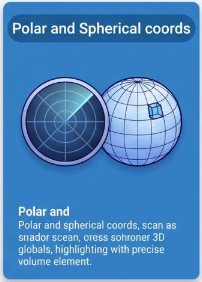
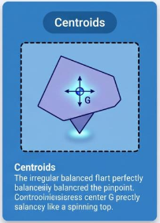

# Visual Mathematics: A Deck of Learning Cards

**[Open the live website](https://hzgezi-lynette.github.io/math-learning-cards/)**

This README shows the same nine original learning cards as the website. Select a card image to open its individual PNG file.

## Learning Aids

### Integration

<table>
<tr>
<td align="center"> <strong>Substitution</strong></td>
<td align="center"> <strong>Integration by parts</strong></td>
<td align="center"> <strong>Multiple integrals</strong></td>
<td align="center"> <strong>Polar and Spherical coordinates</strong></td>
<td align="center"> <strong>Centroids</strong></td>
</tr>
</table>

### Complex numbers

<table>
<tr>
<td align="center"> <strong>Exponential form</strong></td>
<td align="center"> <strong>Argand Diagrams</strong></td>
<td align="center"> <strong>de Moivre’s theorem</strong></td>
<td align="center"> <strong>Complex Impedance</strong></td>
</tr>
</table>

**Cards designed by Yige Sun.** Version 1, prepared for educational use. The cards are shared under the [Creative Commons Attribution-NonCommercial-NoDerivatives 4.0 International License](https://creativecommons.org/licenses/by-nc-nd/4.0/).
