# Visual Mathematics: A Deck of Learning Cards

**[Open the live website](https://hzgezi-lynette.github.io/math-learning-cards/)**

The collection shows the original nine cards designed by Yige Sun, followed by eight additional cards developed with AI-assisted illustrations in the same visual style. Select an image to open its individual PNG file.

## Learning Aids

### Integration

<table>
<tr>
<td align="center"><a href="math-cards/01-substitution.png">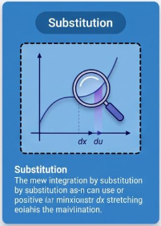</a> <strong>Substitution</strong></td>
<td align="center"><a href="math-cards/02-integration-by-parts.png">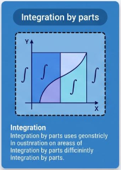</a> <strong>Integration by parts</strong></td>
<td align="center"><a href="math-cards/03-multiple-integrals.png">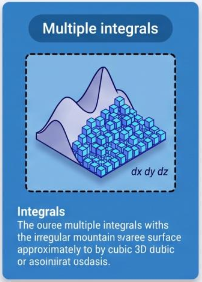</a> <strong>Multiple integrals</strong></td>
<td align="center"> <strong>Polar and Spherical coords</strong></td>
<td align="center"> <strong>Centroids</strong></td>
</tr><tr>
<td align="center"><a href="math-cards/10-improper-integrals.png">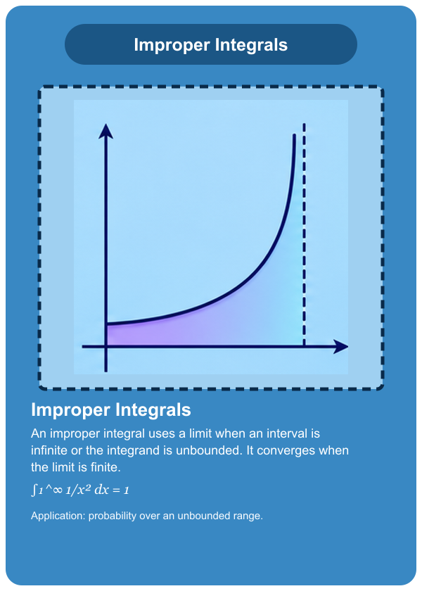</a> <strong>Improper Integrals</strong></td>
<td align="center"><a href="math-cards/11-change-of-variables.png">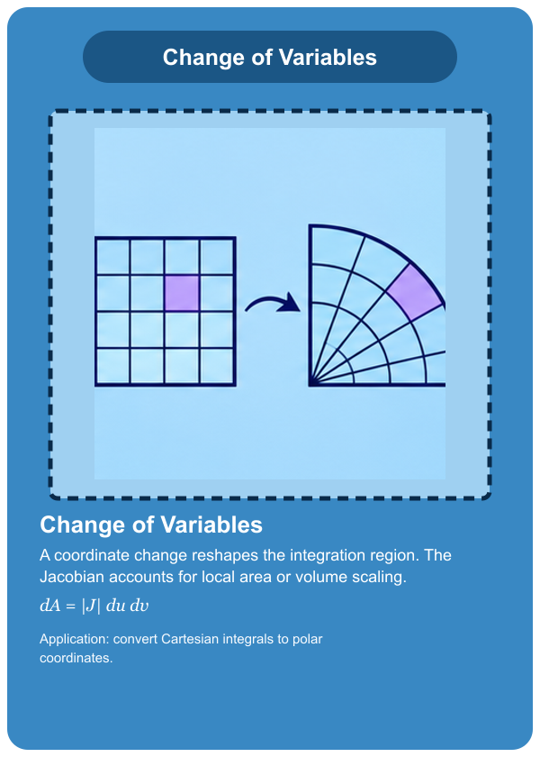</a> <strong>Change of Variables</strong></td>
<td align="center"><a href="math-cards/12-line-integrals.png">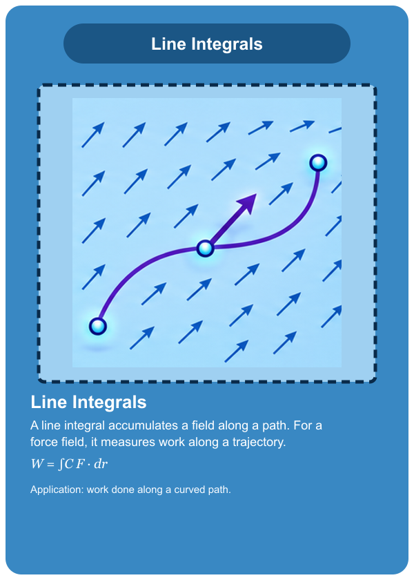</a> <strong>Line Integrals</strong></td>
<td align="center"><a href="math-cards/13-volume-by-slicing.png">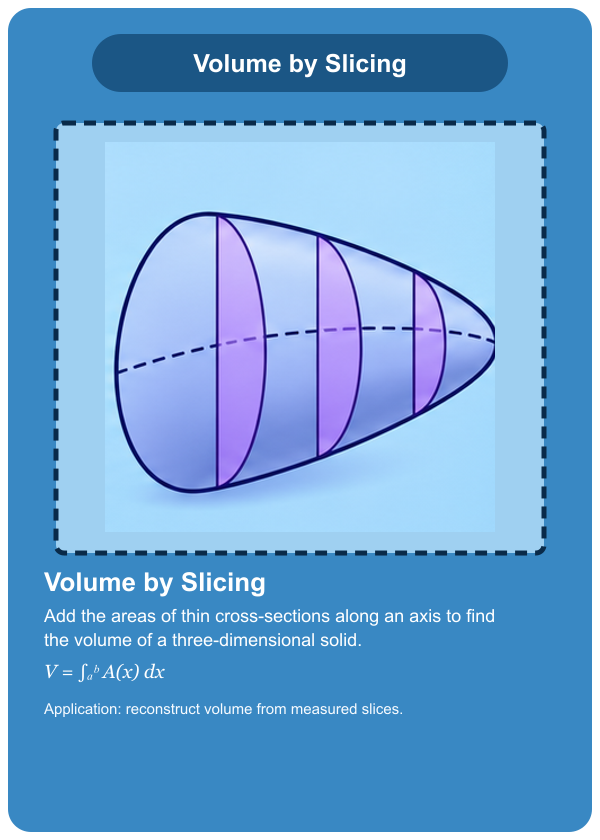</a> <strong>Volume by Slicing</strong></td>
<td></td>
</tr>
</table>

### Complex numbers

<table>
<tr>
<td align="center"><a href="math-cards/06-exponential-form.png">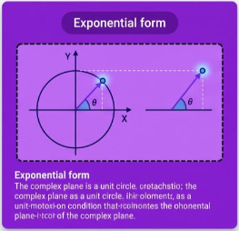</a> <strong>Exponential form</strong></td>
<td align="center"><a href="math-cards/07-argand-diagrams.png">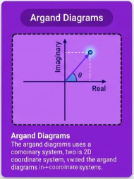</a> <strong>Argand Diagrams</strong></td>
<td align="center"><a href="math-cards/08-de-moivres-theorem.png">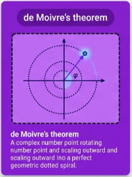</a> <strong>de Moivre's theorem</strong></td>
<td align="center"><a href="math-cards/09-complex-impedance.png">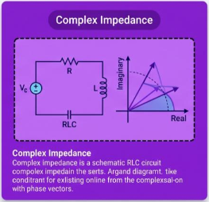</a> <strong>Complex Impedance</strong></td>
</tr><tr>
<td align="center"><a href="math-cards/14-complex-conjugates.png">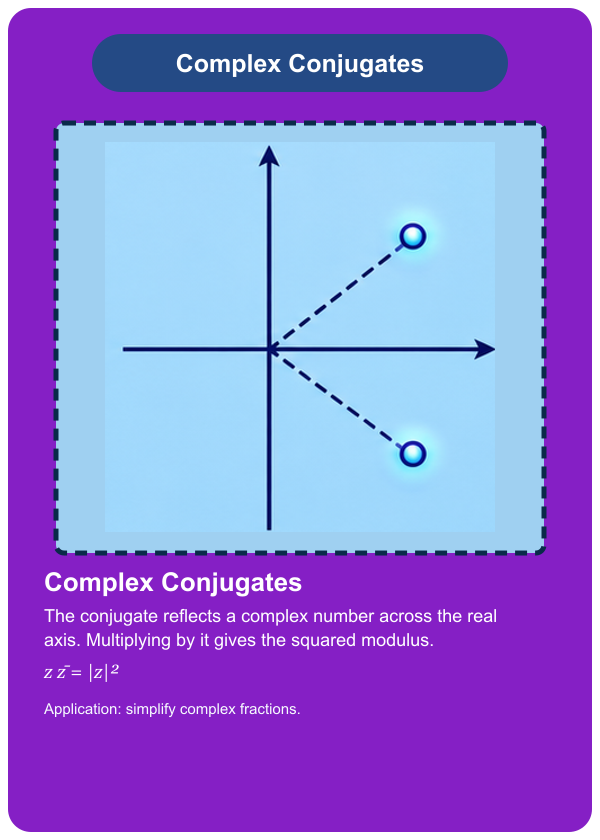</a> <strong>Complex Conjugates</strong></td>
<td align="center"><a href="math-cards/15-modulus-and-argument.png">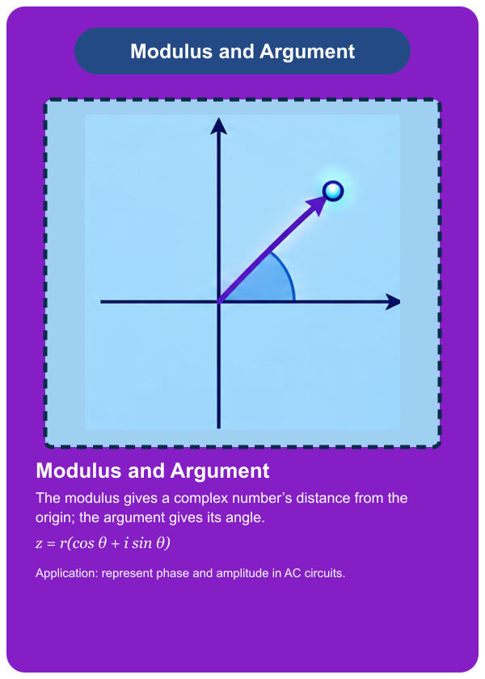</a> <strong>Modulus and Argument</strong></td>
<td align="center"><a href="math-cards/16-complex-multiplication.png">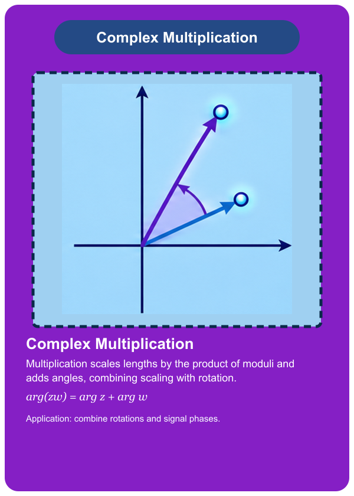</a> <strong>Complex Multiplication</strong></td>
<td align="center"><a href="math-cards/17-roots-of-unity.png">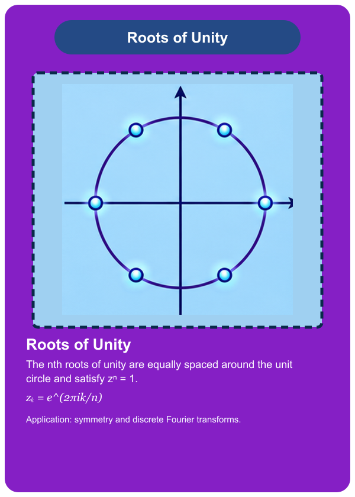</a> <strong>Roots of Unity</strong></td>
</tr>
</table>

The original nine cards were designed by Yige Sun. The additional cards were developed with AI-assisted illustrations following the same design principles. The collection is shared for educational use under the [Creative Commons Attribution-NonCommercial-NoDerivatives 4.0 International License](https://creativecommons.org/licenses/by-nc-nd/4.0/).
